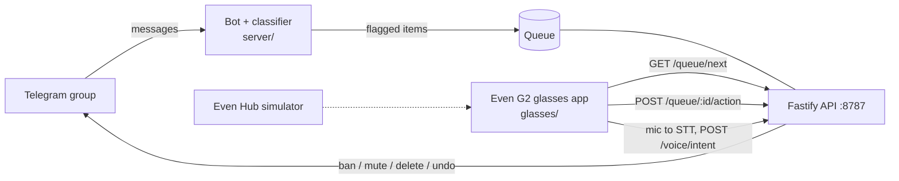

# Gavel

> Started from a prototype built before the event.

Glasses-first moderation queue for Telegram groups on Even Realities G2 (576x288 monochrome, gestures only, no camera or speaker). Built for the Heads Up hackathon.

## Problem

Crypto community moderators are always on call. Scams arrive in bursts (fake support, wallet drainer links, impersonated admins, giveaways), and each one needs a read, a decision and an action in a few seconds, before members click. Phones demand unlocking, switching apps and scrolling a busy chat. Gavel puts the single most urgent flagged message in front of your eyes and lets you act with one gesture or one spoken phrase.

## How it works

1. A Telegram bot sits in your group as admin and reads messages.
2. A rules-first classifier (links, "DM me", "support", seed phrase and wallet words, new accounts) scores each message. An optional LLM refines the score when an LLM key is set. Rules alone work offline.
3. Flagged messages go into a queue. The glasses app shows the oldest highest-risk item: risk level, reason, sender and the text.
4. You act:

| Gesture | Action |
|---|---|
| Press | Runs the suggested action shown in the footer (repeat offenders and high risk escalate: ignore, mute 1 h, mute 24 h, ban + delete 10). Undo within 60 s |
| Double press | Ignore (for a scam wave, ignores every item in the wave) |
| Swipe down | Next / skip |
| Swipe up | Undo the last action, or the whole wave (valid 60 s) |
| Long press | Voice command, e.g. "mute for a day", "ban and delete their last 10". The parsed command is shown and needs a press to confirm. |

Also: when several accounts post the same scam in one chat, the card shows WAVE xN and one press (or double press) acts on the whole wave, using the gentlest suggested action, and swipe up undoes it all. A NEW HIGH banner appears when more high-risk items arrive while you view a card, the card itself never changes under you, and the empty screen shows a shift summary. `GET /audit` lists every action.

Nothing is ever moderated automatically. The server only acts when the glasses send an explicit action.

## Architecture



The API contract is in `CONTRACT.md`.

## Setup

1. **Create the bot.** In Telegram, open @BotFather, send `/newbot`, and copy the token. Send `/setprivacy`, pick your bot and choose Disable so it can read group messages.
2. **Make the bot admin** of a **test group** with the rights to delete messages and ban/restrict users.
3. **Configure env.** Copy `server/.env.example` to `server/.env` and fill in the bot token and a `PAIRING_CODE`. `LLM_API_KEY` and `STT_API_KEY` are optional. Tested providers: OpenRouter for the LLM (`LLM_BASE_URL=https://openrouter.ai/api/v1`, `LLM_MODEL=openai/gpt-4o-mini`) and Groq Whisper for speech-to-text (`STT_BASE_URL=https://api.groq.com/openai/v1`, `STT_MODEL=whisper-large-v3-turbo`).
4. **Run the server** (see `server/` for the exact commands, typically `npm install && npm run dev`). Check `GET http://localhost:8787/health`.
5. **Run the glasses app** from `glasses/` (see its README for the dev command). Enter the pairing code once on first launch.
6. **Run the simulator.** Start the Even Hub simulator against the glasses app dev URL, per the [Even Hub docs](https://hub.evenrealities.com/docs/get-started/overview).
7. **Fill the queue.** With no Telegram, call `POST /dev/seed`. With Telegram, post the sample messages from `demo/scam-messages.json`:

```sh
POSTER_BOT_TOKEN=... TEST_CHAT_ID=-100123... node demo/post-test-messages.mjs
node demo/post-test-messages.mjs --dry-run
```

Telegram does not deliver bot messages to other bots in groups. So a second poster bot fills the group visually, but for the moderation bot to classify messages, post them from a human test account (paste the text from the JSON) or use `POST /dev/seed`.

## Safety notes

- No auto-moderation. Every ban or mute needs an explicit gesture or confirmed voice command.
- Undo is available for 60 seconds after any action. Deleted messages cannot be restored by Telegram, so undo restores the user, not the text.
- Test group only while developing. Do not add the bot to a real community until you have reviewed the classifier's false positives.
- No keys are committed. Tokens and the LLM key live only in `server/.env`, which is git-ignored, and are never logged.
- Privacy: with `LLM_API_KEY` set, the text of every group message (first 400 characters) is sent to the LLM provider you configure, and with `STT_API_KEY` set, voice commands are sent to the speech provider. Leave both unset to keep everything on your server. Use a test group only.
- Evaluation messages in `demo/scam-messages.json` use `.example` domains and placeholder values.

## Evaluation data

`demo/scam-messages.json` has 25 labelled messages (high, medium, low) covering fake support, drainer links, giveaways, impersonated admins, phishing and benign chatter. Use it to measure classifier precision and recall.

`demo/holdout-messages.json` has 20 further messages (10 scams, 10 hard benign cases such as real warnings, docs links and legitimate "DM me" offers). It was written after the rules, scored once before any tuning, and then used to fix one false positive, so it is no longer a clean test.

Rules-only results (`server/test/eval.test.ts`): dev set 14/14 scams flagged, 0 false positives (tuned on this set); held-out set 7/10 scams flagged, 0 false positives after the fix (8/10 with 1 false positive before it). Misses are phrased without any rule keyword, which is what the optional LLM pass (`LLM_API_KEY`) is for; with a key set, the LLM reviews every message, including ones the rules score at 0, so it can catch scams with no rule keyword. That means one LLM call per group message, with a 2.5 second timeout, and the rules verdict is kept if the call fails. A model score of 0.65 or higher flags a message on its own; weaker scores are averaged with the rules score.

Live check with OpenRouter (`openai/gpt-4o-mini`) on the 20-message held-out set: rules + LLM flagged 10/10 scams with 0 false positives (rules alone: 7/10). The first prompt did not say which way the score runs and returned 0 for an obvious scam; the fixed prompt, including a line that warnings are harmless, was written after seeing this set, so the set is not clean. It is a smoke test of 20 messages, not an accuracy claim.

## Before and during the hackathon

Started from a prototype built before the event. Commits after the first one in this repository were made during the hackathon.

## Feature requests for Telegram / Even Hub APIs

1. **Even Hub: continuous voice capture API.** Today a voice command needs a long press and a bounded mic session. A push-to-talk stream with partial STT results would let moderators speak "ban and delete their last ten" and see the parsed intent form live.
2. **Even Hub: text-wrapping and font metrics for the 576x288 canvas.** A measure call that returns wrapped line counts would let us fit a message, a reason, and an action hint without trial and error.
3. **Even Hub: background notifications or wake on glasses.** A way to raise a short glance alert when a high-risk item arrives while the plugin is not in the foreground, so moderators do not have to poll.
4. **Telegram: bot-visible join-age and account-age signals.** Account age is the strongest scam signal and bots cannot read it. A field on `User` or `ChatMember` would improve the rules classifier without any LLM.
5. **Telegram: a reversible "quarantine" moderation primitive.** Ban, mute and delete are blunt and only partly undoable (deleted messages cannot be restored). A hold state that hides a message from members until a moderator approves it would make glasses triage safe by design.

## Docs

- Demo storyboard: `demo/DEMO_SCRIPT.md`
- Submission draft: `demo/SUBMISSION.md`
