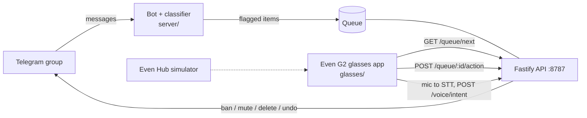

<p align="center"></p>

# Gavel

> Started from a prototype built before the event.

Demo video: https://youtu.be/p-A0uJ_V0dM

Glasses-first moderation queue for Telegram groups on Even Realities G2 (576x288 monochrome, gestures only, no camera or speaker). Built for the Heads Up hackathon.

## Problem

Crypto community moderators are always on call. Scams arrive in bursts (fake support, wallet drainer links, impersonated admins, giveaways), and each one needs a read, a decision and an action in a few seconds, before members click. Phones demand unlocking, switching apps and scrolling a busy chat. Gavel puts the single most urgent flagged message in front of your eyes and lets you act with one gesture or one spoken phrase.

## How it works

1. A Telegram bot sits in your group as admin and reads messages.
2. A rules-first classifier (links, "DM me", "support", seed phrase and wallet words, new accounts) scores each message. An optional LLM refines the score when an LLM key is set. Rules alone work offline.
3. Flagged messages go into a queue. The glasses app shows the oldest highest-risk item: risk level, reason, sender and the text.
4. You act:

| Gesture | Action |
|---|---|
| Press | Runs the suggested action shown in the footer (repeat offenders and high risk escalate: ignore, mute 1 h, mute 24 h, ban + delete 10). Undo within 60 s |
| Double press | Ignore (for a scam wave, ignores every item in the wave) |
| Swipe down | Next / skip |
| Swipe up | Undo the last action, or the whole wave (valid 60 s) |
| Long press | Voice command, e.g. "mute for a day", "ban and delete their last 10", or "mute the wave" for the whole wave on the card. The parsed command is shown and needs a press to confirm. |

Also built for real shifts (details and test status below): a raid alert to on-call moderators (Telegram DM and phone call), member reports by forwarding a scam DM, several moderators on one queue, a new-joiner label, a response-time ranking, a "since you were away" line, raid replay and opt-in night mode.

Also: when several accounts post the same scam in one chat, the card shows WAVE xN and one press (or double press) acts on the whole wave, using the gentlest suggested action, and swipe up undoes it all. A NEW HIGH banner appears when more high-risk items arrive while you view a card, the card itself never changes under you, and the empty screen shows a shift summary. `GET /audit` lists every action.

Nothing is moderated automatically, with one opt-in exception. The server acts only when the glasses send an explicit action, unless an admin has switched on night mode for a group with /night on (off by default, see below). The raid alert only wakes people and never acts.

## Architecture



The API contract is in `CONTRACT.md`.

## Setup

1. **Create the bot.** In Telegram, open @BotFather, send `/newbot`, and copy the token. Send `/setprivacy`, pick your bot and choose Disable so it can read group messages.
2. **Make the bot admin** of a **test group** with the rights to delete messages and ban/restrict users.
3. **Configure env.** Copy `server/.env.example` to `server/.env` and fill in the bot token and a `PAIRING_CODE`. `LLM_API_KEY` and `STT_API_KEY` are optional. Tested providers: OpenRouter for the LLM (`LLM_BASE_URL=https://openrouter.ai/api/v1`, `LLM_MODEL=openai/gpt-4o-mini`) and Groq Whisper for speech-to-text (`STT_BASE_URL=https://api.groq.com/openai/v1`, `STT_MODEL=whisper-large-v3-turbo`).
4. **Run the server** (see `server/` for the exact commands, typically `npm install && npm run dev`). Check `GET http://localhost:8787/health`.
5. **Run the glasses app** from `glasses/` (see its README for the dev command). Enter the pairing code once on first launch.
6. **Run the simulator.** Start the Even Hub simulator against the glasses app dev URL, per the [Even Hub docs](https://hub.evenrealities.com/docs/get-started/overview).
7. **Fill the queue.** With no Telegram, call `POST /dev/seed`. With Telegram, post the sample messages from `demo/scam-messages.json`:

```sh
POSTER_BOT_TOKEN=... TEST_CHAT_ID=-100123... node demo/post-test-messages.mjs
node demo/post-test-messages.mjs --dry-run
```

Telegram does not deliver bot messages to other bots in groups. So a second poster bot fills the group visually, but for the moderation bot to classify messages, post them from a human test account (paste the text from the JSON) or use `POST /dev/seed`.

## Safety notes

- No auto-moderation. Every ban or mute needs an explicit gesture or confirmed voice command.
- Undo is available for 60 seconds after any action. Deleted messages cannot be restored by Telegram, so undo restores the user, not the text.
- Test group only while developing. Do not add the bot to a real community until you have reviewed the classifier's false positives.
- No keys are committed. Tokens and the LLM key live only in `server/.env`, which is git-ignored, and are never logged.
- Privacy: with `LLM_API_KEY` set, the text of every group message (first 400 characters) is sent to the LLM provider you configure, and with `STT_API_KEY` set, voice commands are sent to the speech provider. Leave both unset to keep everything on your server. Use a test group only.
- Evaluation messages in `demo/scam-messages.json` use `.example` domains and placeholder values.

## Evaluation data

`demo/scam-messages.json` has 25 labelled messages (high, medium, low) covering fake support, drainer links, giveaways, impersonated admins, phishing and benign chatter. Use it to measure classifier precision and recall.

`demo/holdout-messages.json` has 20 further messages (10 scams, 10 hard benign cases such as real warnings, docs links and legitimate "DM me" offers). It was written after the rules, scored once before any tuning, and then used to fix one false positive, so it is no longer a clean test.

Rules-only results (`server/test/eval.test.ts`): dev set 14/14 scams flagged, 0 false positives (tuned on this set); held-out set 7/10 scams flagged, 0 false positives after the fix (8/10 with 1 false positive before it). Misses are phrased without any rule keyword, which is what the optional LLM pass (`LLM_API_KEY`) is for; with a key set, the LLM reviews every message, including ones the rules score at 0, so it can catch scams with no rule keyword. That means one LLM call per group message, with a 2.5 second timeout, and the rules verdict is kept if the call fails. A model score of 0.65 or higher flags a message on its own; weaker scores are averaged with the rules score.

Live check with OpenRouter (`openai/gpt-4o-mini`) on the 20-message held-out set: rules + LLM flagged 10/10 scams with 0 false positives (rules alone: 7/10). The first prompt did not say which way the score runs and returned 0 for an obvious scam; the fixed prompt, including a line that warnings are harmless, was written after seeing this set, so the set is not clean. It is a smoke test of 20 messages, not an accuracy claim.

## Raid alert (wakes you, never acts)

When 2 or more different accounts post the same high-risk scam in one group, Gavel alerts the people on call, once per raid (10 minute cooldown per group). It only wakes people up. It never mutes, deletes or bans anything, and every action still needs a gesture or a confirmed voice command.

- **Telegram DM:** send /oncall to the bot in a private chat to opt in, /off to stop. A bot can only message you after you have started it.
- **Phone call (optional):** set TWILIO_ACCOUNT_SID, TWILIO_AUTH_TOKEN, TWILIO_FROM, ONCALL_PHONES (comma separated, +country format) and PUBLIC_URL (a URL Twilio can reach, for the spoken message). Twilio trial accounts can only call numbers you verified, play a trial notice first, and reject inline TwiML, which is why the message is fetched from PUBLIC_URL/twiml/raid. The endpoint only ever reads the last raid text and takes no input.
- **Tested:** unit tests (threshold, distinct accounts, cooldown, failures in one channel). The threshold is 2 accounts by default and can be changed with RAID_THRESHOLD. Live: a real raid from two accounts in the test group sent the DM, and a Twilio trial call to a verified number was heard speaking the message (it first failed because the server rejected Twilio's form-encoded request, which is fixed). Not tested: a raid from three accounts, and whether a call wakes anyone at 3 a.m.
- Local test: POST /dev/raid-test (non-production only) fires a labelled test alert.

## Member reports (forward a scam DM)

The bot cannot read private chats between other people, so members can report a DM instead: forward it to the bot in a private chat. The bot checks that the reporter is a member of a group it moderates, allows at most 5 reports per reporter per 10 minutes, and queues the message as a REPORTED card (REPORTED x5 when five members report the same sender). One card is created for each moderated group the scammer is in, so the usual mute or ban gesture works unchanged, with the usual undo.

- If the scammer hides forwarding, Telegram gives only a display name. That card is shown as hidden sender and can only be ignored, because there is no account to act on.
- Reports are scored by the rules only (no LLM), and are never lower than medium, because a person reported them.
- Nothing is acted on automatically. The group list is built from the groups the bot has seen messages in since it started; set MODERATED_CHATS (comma separated chat ids) to preload it after a restart.
- **Tested:** unit tests (reporter check, rate limit, merging, hidden sender, no Telegram call before an explicit action), and live on a Telegram test group with two accounts: a forward from an account that hides its name became a hidden-sender card (ignore only), and a forward from a normal account became a REPORTED card whose mute worked and whose undo restored sending. Not tested: five different reporters, or a real ban.

## Teamwork (several moderators, one queue)

Set MODERATORS=maya:code1,alex:code2 (name:pairing code, comma separated) and give each moderator their own code in the glasses app. PAIRING_CODE keeps working as a generic moderator.

- **Who is on it:** a card a moderator opened in the last 30 seconds is skipped for the others. If it is the only card left, they still see it with a line "Maya is on this". The lock expires by itself, so a moderator who dozes off never blocks the queue.
- **Safe at the same time:** an item is claimed before any action runs. If two moderators press at once, exactly one acts and the other gets "Already handled by Maya" instead of an error.
- **Audit:** every action records who did it (GET /audit has a by field), and GET /queue/stats has byModerator counts.
- **Tested:** unit tests with two codes (separate cards, viewer line, lock expiry, simultaneous presses, audit and stats). Not tested: two real glasses at once, or a shift handoff screen (not built).

## More for real-life shifts

- **"Mute the wave" by voice.** Saying "mute the wave" or "ban all of them" applies the action to the whole wave on the card and also deletes the scam post of each account (plain "mute for a day" does not delete anything). The confirm screen says "whole wave (N users)". "mute for a day" still acts on one account. Tested: intent parsing, and in the Even Hub simulator with a recorded phrase, on a seeded wave of 4 and on a live wave of 2 accounts in the test group (confirm screen said "whole wave (4 users)", one press muted all 4). Not tested with a real voice or real glasses.
- **New-joiner flag.** The bot notes when someone joins and marks their first flagged post within 24 hours as "NEW 12m" on the card. It only labels. It does not change the score. Tested live in the Telegram test group (the card showed NEW 0m after a rejoin).
- **Moderator response ranking.** Every action stores how long the card waited. GET /moderators ranks moderators by median response time. Tested in unit tests.
- **"Since you were away".** If a moderator opens the queue after 10 minutes or more, the first card starts with a line such as "Away 30m: 7 new, 5 handled (Maya 3), 1 raid. 2 left." Tested in unit tests only.
- **Raid replay.** Raids of 2 or more accounts are recorded. GET /raids, /raids/:id and a browser page at /raids/view?code=PAIRING_CODE show who posted first, when Gavel grouped them, and who acted and how fast. Tested live in the test group (a 2-account raid was recorded and replayed).
- **Night mode (off by default, the only automatic action).** An admin sends /night on to the bot in a private chat. Only while no moderator has opened Gavel for 10 minutes, 3 or more accounts posting the same high-risk scam are muted for 60 minutes and their posts deleted. It never bans. A CONTAINED card shows who was muted. Swipe up restores them, and the bot re-posts "[restored by mods] @user said: ...". Restore works for 12 hours. Tested with mocks, and live in the test group with the threshold lowered to 2 for testing (the real default is 3 accounts and 10 idle minutes): chris was muted and restored. The owner account cannot be muted by Telegram. Telegram leaves a restored user with all permissions switched on rather than their old ones.

Not built: Business inbox, join warnings, a shared "banned elsewhere" list, chat lock, assigning cards to a moderator.

## Before and during the hackathon

Started from a prototype built before the event. Commits after the first one in this repository were made during the hackathon.

Added during the event (commits after the first one):

- The LLM now reviews every message, not only borderline ones. A model score of 0.65 or higher flags a message on its own, so scams with no keywords are caught.
- Fixed the score direction in the LLM prompt, added Groq and OpenRouter configuration, and a 2.5 s LLM timeout so the queue never stalls.
- A privacy note, and rewritten submission text and demo script that match the code.
- Logo, and a recorded demo using the Even Hub simulator.
- Teamwork: named moderators, "Maya is on this", and a safe response when two press at once.
- Member reports: forward a scam DM to the bot and it becomes a REPORTED card.
- Raid alert: Telegram DM and optional Twilio call to on-call moderators when a wave of 2 or more accounts hits.
- Voice "mute the wave", new-joiner flag, moderator response ranking, "since you were away" line, raid replay, and opt-in night mode (see above).

Everything was tested in the simulator and a Telegram test group, not on real G2 glasses. The demo's voice command used a recorded phrase played into the simulator, and the wave shown is seeded demo data.

## Feature requests for Telegram / Even Hub APIs

1. **Even Hub: continuous voice capture API.** Today a voice command needs a long press and a bounded mic session. A push-to-talk stream with partial STT results would let moderators speak "ban and delete their last ten" and see the parsed intent form live.
2. **Even Hub: text-wrapping and font metrics for the 576x288 canvas.** A measure call that returns wrapped line counts would let us fit a message, a reason, and an action hint without trial and error.
3. **Even Hub: background notifications or wake on glasses.** A way to raise a short glance alert when a high-risk item arrives while the plugin is not in the foreground, so moderators do not have to poll.
4. **Telegram: bot-visible join-age and account-age signals.** Account age is the strongest scam signal and bots cannot read it. A field on `User` or `ChatMember` would improve the rules classifier without any LLM.
5. **Telegram: a reversible "quarantine" moderation primitive.** Ban, mute and delete are blunt and only partly undoable (deleted messages cannot be restored). A hold state that hides a message from members until a moderator approves it would make glasses triage safe by design.

## Docs

- Demo storyboard: `demo/DEMO_SCRIPT.md`
- Submission draft: `demo/SUBMISSION.md`
